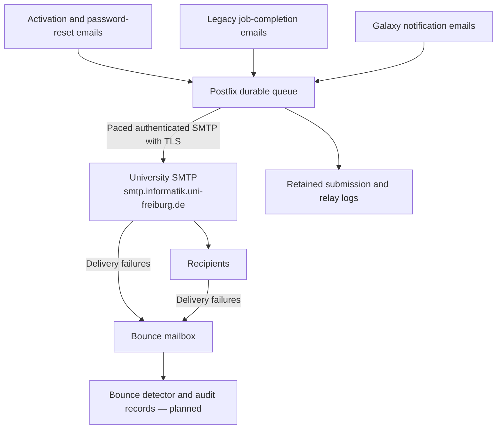

# Galaxy university SMTP relay

Local role addressing [SMTP rate limits (#984)](https://github.com/usegalaxy-eu/issues/issues/984)
and [user-contact tracking (#1028)](https://github.com/usegalaxy-eu/issues/issues/1028).
Supported targets: Debian 12, EL 9 and Rocky Linux 10, with Postfix >= 3.1.
Optional local IMAP storage requires Dovecot 2.3; Dovecot 2.4 is not supported.
The role owns `main.cf` and, in local bounce mode, `dovecot.conf` on a dedicated host.

## System architecture



Galaxy sends all email through one relay. This includes legacy job-completion
emails, which are independent of notification-system preferences and caused the
flood described in #984. Postfix accepts messages into a durable queue and paces
delivery to the existing university SMTP account. Temporary SMTP rejections can
then be retried without depending on each Galaxy caller implementing retries.
Galaxy still needs to handle failures occurring before Postfix accepts a message.

RZ limits connections/authentication attempts per source host and recipients per
authenticated account, **not per visible sender address**. Its example permits
750 recipients/hour: 170,000 recipients take about 9.5 days at that rate.
Confirm the exact time windows and connection/authentication limits before rollout.

The initial deployment uses **one account**. Random multi-account routing is
removed. Changing sender addresses does not create quota. Connection reuse is
disabled initially: paced short sessions must be validated against RZ's limits.
Bounded TLS connection reuse can be investigated separately; do not keep idle
connections open for an hour. Postfix shared connection caching has limitations
with different SASL accounts on the same mail server.

## Configuration and deployment

Add the relay to the `mailrelay` inventory group. Supply non-secret settings in
`group_vars/mailrelay.yml` and credentials via a protected external variables file
(e.g. `--extra-vars @/secure/mailrelay.yml`). This playbook does not load Vault files.
Never commit real passwords. Example:

```yaml
postfix_relay_hostname: postfix-relay.bi.privat
postfix_relay_interfaces: [127.0.0.1, 10.0.0.20]
postfix_relay_trusted_networks: [127.0.0.0/8, 10.0.0.10/32]
postfix_relay_tls_mode: starttls
postfix_relay_account:
  host: smtp.informatik.uni-freiburg.de
  port: 587
  username: "<approved-university-account>"
  password: "<supply-through-protected-external-vars>"
  rate_delay: 6
postfix_relay_bounce_mode: external
# Optional: only once the address is provisioned and approved by RZ.
postfix_relay_bounce_address: galaxy-bounces@example.org
postfix_relay_envelope_senders:
  - galaxy-no-reply@informatik.uni-freiburg.de
```

Confirm RZ's actual port/TLS mode. Use `starttls` for STARTTLS submission or
`implicit` for implicit TLS (normally port 465). Both modes require certificate
and hostname verification against the OS CA bundle. Galaxy previously used
`smtp_ssl: true`; do not assume the illustrative port 587 is the right endpoint.

```console
ansible-playbook mail-relay.yml --check --diff --extra-vars @/secure/mailrelay.yml
ansible-playbook mail-relay.yml --extra-vars @/secure/mailrelay.yml
```

Configure Galaxy's SMTP endpoint to the private relay address, with SMTP username
and password unset and `smtp_ssl: false`. All Galaxy handlers and Celery workers
must reach that endpoint and have their source IPs explicitly trusted by Postfix.
Loopback works only for processes sharing the relay's host/network namespace.
The role does not configure firewall rules or inbound TLS: keep submission on a
private network and restrict access to approved clients. Restart affected Galaxy
and Celery processes after applying the Galaxy configuration.

## Pacing and campaign admission

The role sets `smtp_transport_rate_delay`, which spaces deliveries across the
entire SMTP transport regardless of recipient/domain, limits the SMTP service to
one process, and uses one recipient per delivery. `rate_delay: 6` corresponds to
approximately **600 recipient deliveries/hour**, leaving margin below 750/hour.
This also spaces normal connection/authentication attempts. Failures, reconnects
and other software using the same account/source host require additional margin.

**This is conservative pacing, not a durable rolling-window quota counter.**
Restarting Postfix can reset pacing state. Confirm recipient and session rates
with RZ under normal load, retry conditions, and recovery from an outage.
Changing the queue-run interval alone does not enforce these limits.

Postfix is a delivery queue, not a campaign scheduler or priority system. Bulk
messages can delay activation/password-reset mail. A small application-side
campaign scheduler should release recipients gradually, reserve ordinary-mail
capacity, persist campaign progress and pause when queue depth/age rises.
It should not duplicate Postfix's SMTP retry queue.

At 600/hour, 170,000 messages take about **11.8 days**, before routine mail and
retries. Do not enqueue the whole campaign against the default **10-day** queue
lifetime. Keep a short, sendable backlog and store remaining campaign recipients
outside Postfix. Increasing queue lifetime does not increase sending capacity.
Temporary errors are retried until expiry; permanent 5xx rejections may bounce
immediately. SMTP queue admission does not guarantee eventual delivery.

## Bounce storage and tracking

`postfix_relay_bounce_mode` selects:

* **`external` (default):** use a university-hosted mailbox. No Dovecot or local
  bounce aliases are configured, and no inbound bounce forwarding is needed.
  Provision the address and IMAP access with RZ. The relay does not connect to
  that mailbox: the planned detector will poll it directly.
* **`local`:** install Dovecot and a Maildir at `/var/lib/galaxy-bounces/Maildir`.
  Set `postfix_relay_bounce_address` and `postfix_relay_imap_password_hash`.
  Generate a hash with `doveadm pw -s SHA512-CRYPT`. The locked system user uses
  separate IMAP authentication. IMAP listens on `127.0.0.1:143` (configurable);
  remote readers must use an SSH tunnel. Arrange university forwarding to this
  relay, preserving the public recipient or addressing the local mailbox user
  at the relay hostname. A local alias alone does not receive remote bounces.

Optional exact entries in `postfix_relay_envelope_senders` rewrite SMTP envelope
senders to `postfix_relay_bounce_address`, preserving visible From and Reply-To.
Every upstream sender identity must be authorized by RZ. Null envelope senders
used by DSNs are not rewritten. If the address is not yet provisioned, leave
the rewrite list empty; normal sender behaviour is preserved.

On switching local to external mode, the role stops a previously managed
Dovecot service when service management is enabled, but retains mailbox data.
Local aliases are no longer referenced by the generated Postfix configuration.

**The bounce detector and persistent audit database are planned, not implemented.**
The detector should parse RFC 3464 DSNs, distinguish delay warnings from permanent
failures, persist recipient/Message-ID/diagnostic/timestamp records, and deduplicate
IMAP messages using mailbox identity, UIDVALIDITY and UID. Unrecognized messages
should remain available for inspection. Notification records can expire; audit
retention must be independent. Absence of a bounce is not proof of delivery.

## Rocky Linux 10 and SELinux

Red Hat-family hosts use `postfix-lmdb` for local aliases; Rocky 10's base package
does not include the legacy `hash` backend. Aliases are rebuilt on configuration
changes. The OS CA bundle and SASL packages are selected by platform.

On SELinux-enabled Red Hat-family hosts, the role installs management bindings
and assigns `smtp_port_t` to the upstream port. In local bounce mode it additionally
records `user_home_dir_t` / `mail_home_rw_t` mailbox mappings and `pop_port_t` for
the IMAP port, then applies labels. Choose ports not assigned to unrelated
services. SELinux remains enabled. `community.general` is required on the
controller, already declared by the repository.

## Logging, monitoring and operations

Mail-facility logs are retained in `/var/log/galaxy-mail.log`, rotated daily and
compressed for 180 rotations by default. Correlate queue ID, Message-ID, sender,
recipient, timestamps and SMTP results. `status=sent` means **university SMTP
accepted the message**, not final delivery or reading. Subjects and Galaxy
notification IDs are not automatically recorded. Protect and back up logs as
required by audit retention.

`/usr/local/bin/galaxy-mail-metrics` emits queue count, deferred/held counts,
oldest message age and spool free bytes in Influx line protocol. Set
`postfix_relay_telegraf_enabled: true` only with Telegraf already installed.
Alert on growing backlog, oldest age approaching expiry, low disk space and
upstream rejections. Queue inspection works without sudo under Postfix's default
`authorized_mailq_users` setting.

Before rollout, test bursts from all Galaxy mail paths, SMTP 451 recovery,
authentication failures, outages, pacing across recipient domains, restart
behaviour, bounce routing, and activation latency during campaign admission.
Inspect `postqueue -p` before queue operations; avoid repeated bulk flushes.
Stop campaign submission before rollback and drain or retain existing queued
messages: changing Galaxy's SMTP endpoint does not move the queue.

## Reproducible smoke test

`tests/configure.yml` supplies one fake account and a local bounce mailbox for a
disposable Debian 12, EL 9 or Rocky 10 target. Apply twice; the second run should
report `changed=0`. Set `ANSIBLE_ROLES_PATH` to this repository's `roles` directory
if needed. For containers without init, pass `-e postfix_relay_manage_services=false`
and start services manually. Configuration validation still runs.

Run `python3 smoke.py 2525` inside the target with SMTP on the selected port.
The script checks SMTP-to-Maildir-to-IMAP delivery, single-account routing,
credential lookup, pacing configuration, envelope sender mapping and metrics.
Apply with `-e postfix_relay_bounce_mode=external` to test without local mailbox
configuration; the script then skips IMAP delivery. Use
`-e postfix_relay_tls_mode=implicit` to validate implicit-TLS configuration.
These fixtures never send email to the fake upstream server.

With Postfix stopped and an empty disposable queue, run `python3 pacing.py`.
This test temporarily uses a loopback SMTP sink, checks six-second spacing
between deliveries to different domains, and verifies that a 451 rejection
remains queued and succeeds on retry. TLS/authentication are disabled only for
that local sink; original settings are restored in a `finally` block. It stops
Postfix on completion and must never run against a production queue.

Container tests do not replace staging tests for real TLS/authentication,
delivery timing, RZ quota responses, systemd startup or enforcing SELinux.
Debian 12 and Rocky 10 container tests passed for local and external bounce modes,
implicit-TLS configuration, repeat-apply idempotence, cross-domain pacing and
SMTP 451 recovery. Actual university TLS/authentication and restart pacing
remain staging checks.
No repository publishing or production account provisioning is performed.
